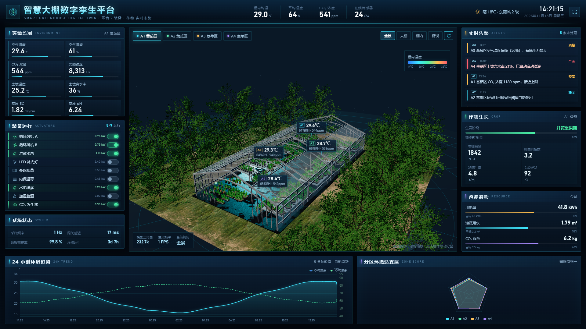
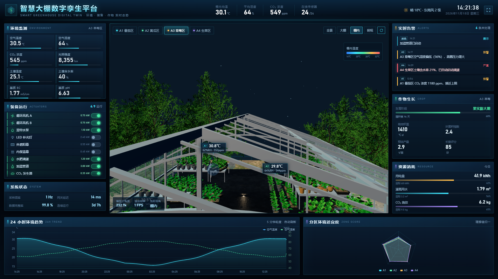

# 智慧大棚数字孪生大屏

园区温室的三维数字孪生大屏：Three.js 实时渲染大棚模型，叠加环境、装备、作物、资源、告警五类运行数据，适配 1080P / 2K / 4K 大屏常驻显示。



棚内视角（点顶栏「棚内」）：



## 快速启动

1. 双击 **`启动大屏.bat`**（自动起本地服务 8090，并以 Chrome kiosk 全屏打开）。
2. 手动方式：

```powershell
py -3 -m http.server 8090 --directory D:\greenhouse
# 或：node D:\greenhouse\server.mjs 8090
```

浏览器访问 `http://localhost:8090/web/index.html`（**必须走 http，不能双击 html 文件**，ES Module 不支持 file 协议）。

退出全屏：`Alt + F4`；停止服务：关闭标题为 `greenhouse-server` 的最小化窗口。

## 界面与操作

| 操作 | 效果 |
| --- | --- |
| 左键拖拽 / 滚轮 | 旋转、缩放（7–130 m） |
| 顶部 全景 / 大棚 / 棚内 / 俯视 | 相机预设，1 s 平滑过渡 |
| 右上角巡航按钮 | 自动环绕开关（默认开） |
| 点击棚体或分区标签 | 联动左侧环境、右侧作物与雷达 |
| 点击装备行 | 启停设备，同时影响模拟环境与资源累计 |
| 右上角全屏按钮 | 进入 / 退出全屏 |

## 目录

```
greenhouse/
├─ web/                     大屏前端
│  ├─ index.html
│  ├─ css/screen.css        1920×1080 设计基准，等比缩放
│  ├─ js/config.js          分区 / 指标 / 设备 / 阈值 / 色板（改这里）
│  ├─ js/data.js            模拟数据引擎（snapshot + onChange 契约）
│  ├─ js/scene.js           Three.js 场景、光照、热区、相机
│  ├─ js/ui.js              面板与 ECharts 图表
│  ├─ js/main.js            入口装配
│  └─ vendor/               three r180、echarts 5.5（已本地化，断网可用）
├─ model/
│  ├─ greenhouse_optimized.glb   大屏加载模型（27.5 MB，1024 贴图）
│  ├─ source/Greenhouse.fbx      原始资产（备份）
│  └─ textures/                  原始 2048 贴图
├─ tools/
│  ├─ build_glb.py          FBX → 优化 GLB（Blender 4.5 无头执行）
│  └─ md2html.mjs           需求文档 Markdown → HTML
├─ docs/
│  ├─ 需求分析.md / .html    需求、数据字典、架构、验收标准
│  ├─ 预览图.png             1920×1080 全景截图
│  └─ 预览图-棚内视角.png
├─ server.mjs               零依赖静态服务（备选）
└─ 启动大屏.bat
```

## 常见改动

| 想改什么 | 改哪里 |
| --- | --- |
| 分区数量、作物、位置 | `web/js/config.js` 的 `ZONES` 与 `data.js` 的 `CROP_BIAS` |
| 指标阈值、量程、单位 | `config.js` 的 `METRICS`、`ALERT_RULES` |
| 设备清单、功率、耦合效果 | `config.js` 的 `DEVICES`、`data.js` 的 `_actuatorEffect()` |
| 主题色、字号、布局 | `css/screen.css` 顶部 `:root` 变量 |
| 模型替换 | 重新导出 `model/greenhouse_optimized.glb`，并核对方位与尺寸 |

## 重建三维资产

原始 FBX 43 MB，直接进浏览器解析慢且依赖贴图相对路径。已用 Blender 4.5 转成内嵌贴图的 GLB，并把 11 张 2048 贴图降到 1024，同时补绑原始 FBX 缺失的苗床材质：

```powershell
& "D:\Blender\blender-4.5.10-windows-x64\blender.exe" --background --factory-startup --python "D:\greenhouse\tools\build_glb.py"
```

脚本内含：重建苗床材质（原始 FBX 的 `Plants` 材质漏配贴图，苗床会呈灰白）→ 贴图降采样 → HASHED 转 CLIP → glTF 导出（Y-up、内嵌贴图）→ GLB 后处理把植被 `alphaMode` 强制为 MASK。

## 性能说明

- 目标机型：i7-10700 / 8 GB / GT730 2 GB。已关闭阴影贴图、限制像素比 1.6、粒子 220 个、无后期处理。
- 场景内置帧率自适应：连续 3 s 低于 26 FPS 自动降至像素比 1.0，高于 55 FPS 再恢复。
- 若棚内视角仍偏卡，可把 `scene.js` 中 `setPixelRatio` 上限调到 1.2，或隐藏远处装饰树（`scene.js` 载入后遍历名称含 `Bush` 的对象设为 `visible=false`）。

## 接入真实数据

数据层已与 UI 解耦，只依赖两个契约：

```js
model.snapshot()          // 返回 { zones, devices, alerts, resource, system, history, avg, selected }
model.onChange(fn)        // 每次数据更新回调，参数同 snapshot
```

对接网关时，新增一个 `WebSocketSource`，把 MQTT/WebSocket 报文映射为同样的 `zones`、`devices` 结构，并在 `main.js` 里替换实例即可，`scene.js` 与 `ui.js` 不需要改动。

## 文档

- 需求分析与设计说明：`docs/需求分析.md`（源）、`docs/需求分析.html`（可直接浏览器阅读 / 打印）
- 重新生成 HTML：`node tools/md2html.mjs`（依赖已放在 `tools/node_modules/marked`，无需联网）


